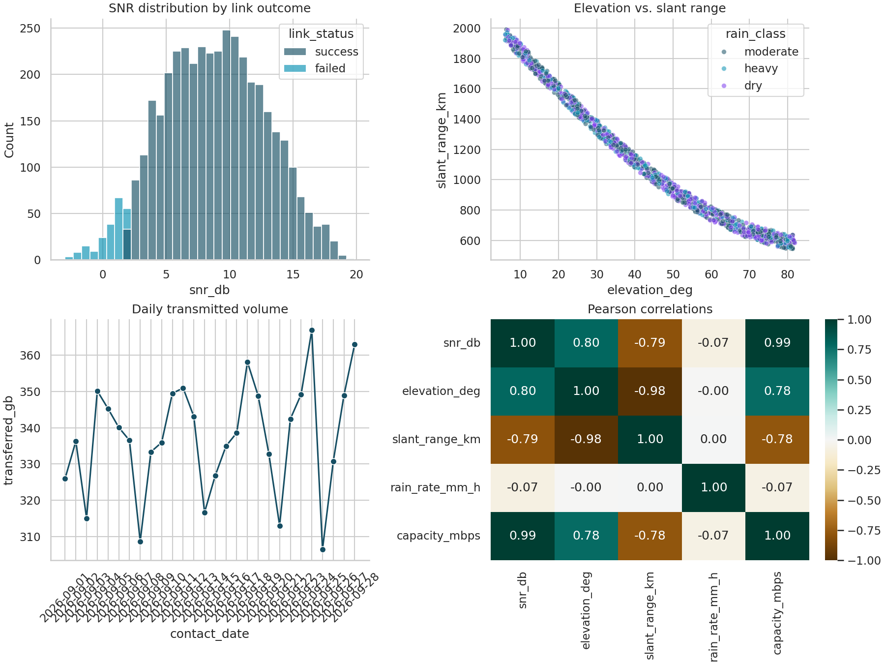

# LEO Data Pipeline

[](https://www.python.org/)
[](LICENSE)
[](https://github.com/eorlovachem-pixel/data-engineering-course/actions/workflows/tests.yml)

Сквозной ETL-пайплайн (Extract, Transform, Load - извлечение, преобразование, загрузка) для обработки данных о сеансах связи низкоорбитальных спутников (LEO - Low Earth Orbit). Проект включает в себя генератор данных, модули очистки, загрузку в базу данных SQLite и подробный разведочный анализ.

## Основные возможности

Генератор данных. Создает синтетические записи по упрощенным физическим формулам (потери в свободном пространстве, формула Шеннона). В данные специально заложены пропуски, дубликаты, запятые вместо точек и физически невозможные значения. Это нужно для того, чтобы было на чем проверять пайплайн очистки.

Очистка (Transform). Проверяет схему, удаляет дубликаты по ключу события, исправляет типы данных, отбрасывает некорректные строки и заполняет пропуски медианами по станциям.

База данных (Load). Загружает очищенные данные в SQLite с соблюдением первичных и внешних ключей, индексов и ограничений целостности. Повторный запуск не создает дублей.

Разведочный анализ (EDA). Строит статические графики в Seaborn и интерактивные дашборды в Plotly. Анализирует распределения, корреляции и влияние погоды на качество связи.

Отчетность. Автоматически сохраняет очищенный CSV, отчет о качестве в формате JSON и сводные таблицы по станциям.

## Технологический стек

Язык Python 3.10+
Обработка данных pandas, numpy
Визуализация matplotlib, seaborn, plotly
Хранение данных SQLite
Тестирование pytest, GitHub Actions (CI)

## Визуализация данных

В проекте подготовлены как статические, так и интерактивные графики. Пример сетки графиков Seaborn размером 2 на 2.



Интерактивная визуализация Plotly доступна по [ссылке на HTML-файл](reports/figures/03_interactive_snr.html).

Важно. GitHub не отображает интерактивные HTML-файлы прямо в браузере. Чтобы посмотреть график, нужно скачать файл 03_interactive_snr.html из репозитория и открыть его в любом браузере у себя на компьютере.

## Быстрый запуск

Для работы нужен Python версии 3.10 или выше. Все команды выполняются в корне репозитория в терминале.

```bash
python -m venv .venv
# Linux/macOS
source .venv/bin/activate
# Windows PowerShell
.venv\Scripts\Activate.ps1

python -m pip install -e ".[dev,notebook]"

# Запуск генератора и полного пайплайна
leo-etl generate --count 4200 --seed 202611
leo-etl run

# Запуск тестов
python -m pytest -q
